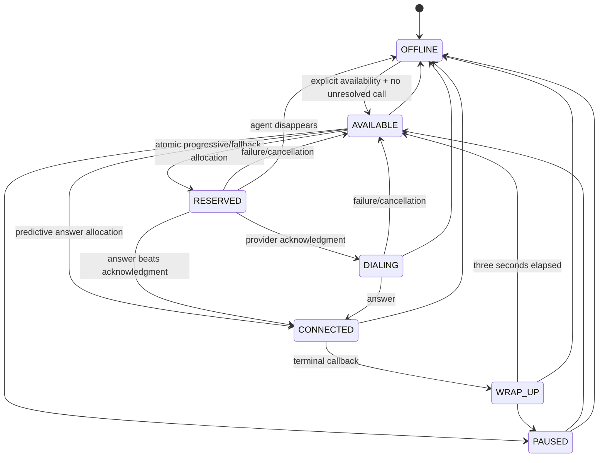

# Agent state machine

`StateMachines.agent` guards manual transitions. RESERVED, DIALING, CONNECTED, and WRAP_UP are service-owned; REST status requests accept only AVAILABLE/PAUSED/OFFLINE. Event processing handles external callbacks that skip intermediate observed states: an ANSWERED callback can bridge directly from RESERVED, and predictive calls acquire an AVAILABLE agent at answer time. These internal shortcuts are intentional and do not expose manual bypasses.

A disappearing agent becomes OFFLINE but keeps its call pointer while the outcome is uncertain. Release removes that pointer; an OFFLINE agent stays OFFLINE. A partial unique index on active call `agent_id` prevents a second simultaneous active bound call even if application logic regresses. Seeded agents require real or explicitly enabled demo heartbeats; availability is not silently refreshed by the backend.
