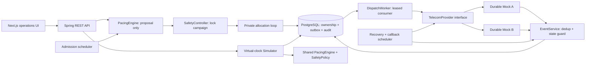

# Architecture diagram

The provider adapter has no role in deciding capacity. Allocation cannot be invoked as a standalone unchecked service. The simulator shares policy code, but does not claim to benchmark the live worker's database/provider throughput.
