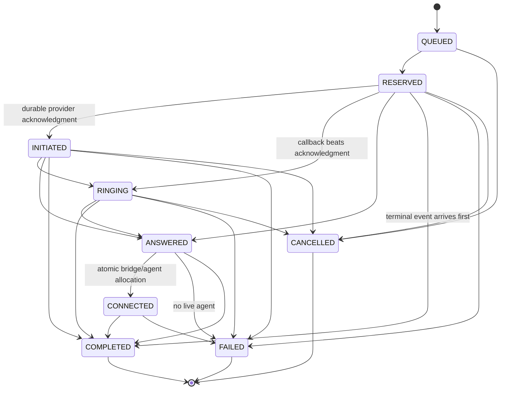

# Call state machine

QUEUED is supported by the transition policy but normal allocation creates the call directly as RESERVED in the same transaction as ownership. ANSWERED is an externally observed event; answering and connection/failure commit in one transaction, so the normal persisted post-event state is CONNECTED or FAILED. The transition policy permits direct CONNECTED internally for this atomic operation. No terminal state has outgoing transitions.

Transport dedup uses provider/event ID uniqueness. Logical duplicates with fresh event IDs are ignored by the transition rules. COMPLETED-before-ANSWERED ends the call without fabricating connection timestamps; later ANSWERED/RINGING remain in the audit table with IGNORED outcomes.
